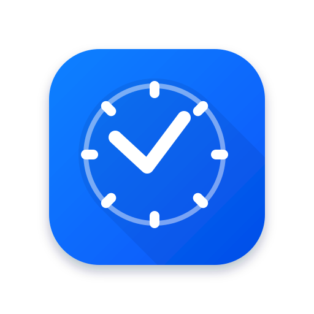

# UniTasker

> An offline-first productivity PWA that combines task management, note-taking, calendar events, resource bookmarks, and a configurable Pomodoro timer — all in a single, responsive app.



---

## Features

### 📋 Task Management
- Full CRUD for tasks with title, description, due date/time, priority, and status
- Filter by status (To Do / In Progress / Completed) and priority (High / Medium / Low)
- Sort by due date, priority, title, or creation date
- Search across title and description
- Reminder field per task

### 📝 Notes
- Create, edit, and delete notes with title and content
- Tag notes and filter by tag
- Full-text search across title, content, and tags
- Card-based grid layout

### 📅 Calendar
- Three views: **Month**, **Week**, **Day**
- Color-coded events with title, description, date, and time
- Click a day with events → popup listing them
- Click empty days → select, stay in current view
- Add / edit / delete events
- Events persist in IndexedDB

### 📁 Resources
- **Two resource types**:
  - **Files** — via File System Access API (Chrome/Edge). Stores a `FileSystemFileHandle` and opens the file from disk on click
  - **Links** — paste any URL (Google Drive, GitHub, YouTube, local paths)
- Automatic file-type icons (PDF, Word, Excel, PowerPoint, code files, images, videos, etc.)
- Grid and table views with sorting
- Search by name, type, or URL
- Tracks "last accessed" timestamp

### ⏱️ Pomodoro Timer
- Configurable durations:
  - Focus length (1–120 minutes)
  - Short break (1–60 minutes)
  - Long break (1–60 minutes)
  - Sessions before long break (1–12)
- Circular progress ring that depletes in real time
- Auto-start breaks / auto-start next focus toggles
- Sound notification (Web Audio API) when a session ends
- Session history logged to IndexedDB
- Live widget on the Dashboard that reflects the running timer
- Timer keeps counting across tab switches

### 🎨 Design & UX
- Dark/Light theme with persistence (respects system preference on first load)
- Responsive layout:
  - Desktop (> 1024px): expandable sidebar
  - Tablet (768–1024px): icon-only sidebar
  - Mobile (< 768px): bottom navigation
- Notification center with unread badge
- Fully offline-capable after first load

### 💾 Data Management
- All data stored locally in **IndexedDB** — nothing leaves the device
- **Export** everything to a single JSON file
- **Import** from a JSON backup (replaces current data with confirmation)
- **Clear all data** with a "type DELETE to confirm" safety net
- Storage statistics dashboard

---

## Tech Stack

| Layer | Choice |
|-------|--------|
| **Framework** | React 18 |
| **Build tool** | Vite |
| **UI library** | Material-UI (MUI) v6 |
| **Icons** | `@mui/icons-material` |
| **State** | React Context API + hooks |
| **Persistence** | IndexedDB via [`idb`](https://github.com/jakearchibald/idb) |
| **PWA** | `vite-plugin-pwa` (Workbox under the hood) |
| **Date pickers** | `@mui/x-date-pickers` + `date-fns` |
| **Offline** | Service Worker + Cache Storage |

---

## Project Structure

```
unitasker/
├── public/
│   ├── favicon.ico                # Legacy favicon
│   ├── favicon.svg                # Vector icon (master)
│   ├── favicon-192x192.png        # PWA icon (any)
│   ├── favicon-512x512.png        # PWA icon (any + maskable)
│   └── offline.html               # Fallback page when offline
│
├── src/
│   ├── components/
│   │   ├── common/                # Navigation, ThemeToggle, NotificationDrawer, OfflineIndicator
│   │   ├── dashboard/             # Dashboard + widgets
│   │   ├── tasks/                 # TaskList, TaskCard, TaskForm, TaskFilters
│   │   ├── notes/                 # NoteList, NoteCard, NoteEditor, NoteFilters
│   │   ├── calendar/              # CalendarView, CalendarGrid, EventList, EventForm
│   │   ├── resources/             # ResourceManager, ResourceCard, ResourceTableRow, LinkFormDialog
│   │   ├── timer/                 # TimerView, CircularTimer, TimerSettingsDialog
│   │   └── settings/              # Settings, ExportDialog, ImportDialog, ClearDataDialog
│   │
│   ├── context/
│   │   ├── ThemeContext.jsx       # Dark/light theme provider
│   │   ├── AppContext.jsx         # DB initialization state
│   │   └── TimerContext.jsx       # Global Pomodoro timer state
│   │
│   ├── hooks/
│   │   ├── useTasks.js
│   │   ├── useNotes.js
│   │   ├── useEvents.js
│   │   ├── useResources.js
│   │   ├── usePomodoro.js
│   │   ├── usePomodoroSettings.js
│   │   ├── useDashboardData.js
│   │   └── useOnlineStatus.js
│   │
│   ├── services/
│   │   ├── database.js            # IndexedDB setup + generic CRUD
│   │   ├── task.service.js
│   │   ├── note.service.js
│   │   ├── event.service.js
│   │   ├── resource.service.js
│   │   ├── timer.service.js
│   │   └── data.service.js        # Export / import / clear
│   │
│   ├── App.jsx                    # Main app + routing
│   ├── main.jsx                   # Entry point + SW registration
│   └── index.css
│
├── index.html
├── vite.config.js
├── package.json
└── README.md
```

---

## Getting Started

### Prerequisites
- **Node.js** 18 or newer
- **npm** 9 or newer
- **Chrome** or **Edge** for the full file-picker experience (Firefox/Safari still work, with reduced Resources features)

### Installation

```bash
# Clone the repo
git clone <your-repo-url>
cd unitasker

# Install dependencies
npm install
```

### Development

```bash
npm run dev
```

Opens on `http://localhost:3000`. Hot module reload is enabled.

### Production build

```bash
npm run build
```

Generates a `dist/` folder with all assets, the service worker, and the manifest.

### Preview the production build

```bash
npm run preview
```

Serves the built app at `http://localhost:4173`. **This is where you should test PWA features** — the service worker is disabled in dev mode.

---

## PWA & Offline

### Installing

1. Open `http://localhost:4173` in Chrome or Edge
2. Look for the **install icon** in the URL bar (a monitor with a down arrow)
3. Click **Install UniTasker**
4. The app opens as a standalone window with the clock icon in your taskbar
5. It stays available even if you go fully offline

### What works offline

Everything:
- All tasks, notes, events, resources (metadata + file handles), and timer sessions
- Creating, editing, and deleting any item
- The Pomodoro timer
- Export / import

### Why?

- All data is stored in **IndexedDB**, which is a persistent, local database
- A **Service Worker** (Workbox) precaches the app shell, so the UI loads even without network
- Cached assets: HTML, CSS, JS bundles, icons, fonts

### Testing offline

1. Open DevTools → **Network** tab
2. Check **Offline**
3. Refresh the page
4. The app loads fully and shows an "Offline" chip in the header

---

## Data Model

### IndexedDB stores

**`tasks`**
```js
{
  id: string,
  title: string,
  description: string,
  dueDate: ISO string | null,
  priority: 'High' | 'Medium' | 'Low',
  status: 'To Do' | 'In Progress' | 'Completed',
  reminder: ISO string | null,
  createdAt: ISO string,
  updatedAt: ISO string
}
```

**`notes`**
```js
{
  id: string,
  title: string,
  content: string,
  tags: string[],
  createdAt: ISO string,
  updatedAt: ISO string
}
```

**`events`**
```js
{
  id: string,
  title: string,
  description: string,
  date: ISO string,        // includes date + time
  time: string,            // "HH:MM"
  color: string,           // hex
  createdAt: ISO string,
  updatedAt: ISO string
}
```

**`resources`**
```js
{
  id: string,
  kind: 'file' | 'link',
  name: string,
  type: string,            // MIME type or 'link'
  size: number,            // bytes (0 for links)
  filePath: string,
  fileHandle: FileSystemFileHandle | null,
  url: string | null,
  description: string,
  uploadedAt: ISO string,
  lastAccessed: ISO string | null,
  metadata: object
}
```

**`timerSessions`**
```js
{
  id: string,
  mode: 'focus' | 'shortBreak' | 'longBreak',
  duration: number,        // seconds
  startedAt: ISO string,
  completedAt: ISO string | null,
  status: 'running' | 'completed' | 'interrupted'
}
```

### localStorage keys

| Key | Stores |
|-----|--------|
| `unitaser-theme` | `'light'` \| `'dark'` |
| `unitaser_pomodoro_settings` | JSON: durations, cycle length, auto-start flags |
| `unitaser_timer_state` | JSON: current mode + remaining seconds |
| `unitaser_notifications` | JSON: array of notification objects |
| `unitaser_auto_breaks` | Legacy boolean (superseded by settings) |

---

## Export / Import

### Export
**Settings → Export Data** produces a single JSON file:

```json
{
  "_meta": {
    "app": "UniTasker",
    "version": "1.0.0",
    "exportFormatVersion": 1,
    "exportedAt": "2025-01-01T12:00:00.000Z",
    "stats": { "tasks": 12, "notes": 8, ... }
  },
  "data": {
    "tasks": [...],
    "notes": [...],
    "events": [...],
    "resources": [...],
    "timerSessions": [...]
  },
  "settings": {
    "unitaser-theme": "dark",
    "unitaser_pomodoro_settings": "{...}"
  }
}
```

### Import
**Settings → Import Data**:
1. Pick the JSON file
2. Preview shows the metadata (exported date, version, item counts)
3. Click **Replace & Import** — this **wipes** existing data and restores from the backup
4. Page reloads automatically

### Clear all data
**Settings → Clear All Data** — type `DELETE` to confirm. Removes everything from IndexedDB and resets all settings.

---

## Browser Support

| Feature | Chrome | Edge | Firefox | Safari |
|---------|--------|------|---------|--------|
| Core app | ✅ | ✅ | ✅ | ✅ |
| IndexedDB | ✅ | ✅ | ✅ | ✅ |
| Service Worker | ✅ | ✅ | ✅ | ✅ |
| PWA install | ✅ | ✅ | ⚠️ partial | ⚠️ partial |
| **File System Access API** | ✅ | ✅ | ❌ | ❌ |
| **Link bookmarks** | ✅ | ✅ | ✅ | ✅ |

**Recommended:** Chrome or Edge for the full experience. Firefox and Safari still work, but Resources falls back to metadata-only file references (users re-select the file to open it).

---

## Known Limitations

- **Resources file handles are Chrome/Edge only** — Firefox and Safari use a metadata-only fallback
- **File handles break if the source file moves or is renamed** — a "file was moved" error is shown; user can re-import
- **PWA install prompt only appears over HTTPS or localhost** — production deploys need SSL
- **No cross-device sync** — this is intentional (offline-first, local-only). Use Export/Import to move data between devices

---

## Scripts

| Command | What it does |
|---------|-------------|
| `npm run dev` | Start Vite dev server at `http://localhost:3000` |
| `npm run build` | Build production bundle into `dist/` |
| `npm run preview` | Serve the built bundle at `http://localhost:4173` |

---

## License

MIT — free to use, modify, and distribute.

---

## Acknowledgements

- Icons by [Material Icons](https://fonts.google.com/icons)
- Component library: [MUI](https://mui.com/)
- IndexedDB wrapper: [`idb`](https://github.com/jakearchibald/idb)
- PWA tooling: [`vite-plugin-pwa`](https://vite-pwa-org.netlify.app/)